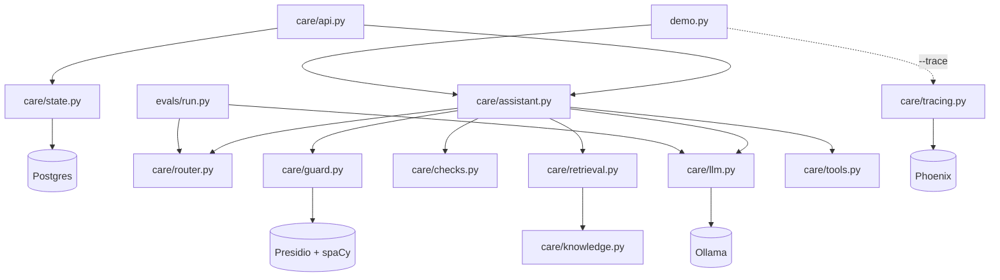

# Components

What every module does, what it exposes, and why it's built the way it is.
For how they fit together, see [architecture.md](architecture.md).

## Dependency map

Arrows point from a module to what it imports. `llm.py` is the only module
that knows about Ollama; everything else takes an `llm` callable, which is what
lets the tests swap in a fake.

`router.py`, `checks.py`, `tools.py` and `knowledge.py` have no project
imports. They're pure and testable on their own.

---

## `care/assistant.py` — the pipeline

**Role:** orchestrates one message end to end and owns the route handlers.

| Name | What it is |
|---|---|
| `handle(text, session, llm=llm.chat) -> Reply` | Public entry point. Opens the `handle` span, runs the pipeline, turns any exception into a handoff, redacts output, records decision attributes. |
| `Reply` | Dataclass: `text`, `route`, `handoff`, `blocked` (list of reason strings). |
| `HANDOFF_TEXT` | The one message a customer sees on any handoff. |
| `SYSTEM` | System prompt for bundle answers. Contains the canary from `checks.CANARY`. |
| `_pipeline` | redact → high-risk → classify → confidence gate → dispatch. |
| `_balance`, `_outage`, `_fault` | Call one tool each and fill a fixed template. No model involved. |
| `_bundle` | Retrieve → answer with the model → run output checks. |

**Design notes**

- The fault ticket's `summary` is a fixed label. Customer text never reaches a
  backend from here.
- `_bundle` computes the allowed prices from the retrieved docs only, so the
  price check is relative to what the model was actually shown.
- The customer message is wrapped in `<<<` `>>>` delimiters in prompts so the
  model can tell data from instructions.

---

## `care/router.py` — high-risk rules and intent classifier

**Role:** decides where a message goes.

| Name | What it is |
|---|---|
| `HIGH_RISK` | Compiled regex: SIM swap/replace/change, PIN/PUK/password, reverse/reversal/refund, "money back", sent/paid to the wrong number. |
| `is_high_risk(text) -> bool` | Regex search. Runs before the model. |
| `INTENTS` | `bundle_info`, `balance`, `outage`, `fault_report`, `other`. |
| `LANGUAGES` | `en`, `sn` (Shona), `nd` (Ndebele), `other`. |
| `CONF_MIN` | `0.6`. Below this, hand off. |
| `FALLBACK` | `{"intent": "unknown", "language": "other", "confidence": 0.0}`. |
| `validate(raw) -> dict` | Parses and checks classifier JSON; raises `ValueError` with a reason the model can act on. |
| `classify(text, llm) -> dict` | Calls the model in JSON mode. On invalid output, sends the error back once and retries. Then falls back. |

**Design notes**

- High-risk detection is regex on purpose: it's deterministic, auditable, and
  can't be talked out of its decision by a prompt injection.
- The classifier prompt tells the model to put injection attempts under
  `other`, which hands off.
- `unknown` is never returned by the model; it only comes from `FALLBACK`.

**To change:** add a high-risk phrase → edit `HIGH_RISK`, add a labelled case
to `evals/golden.jsonl` (`test_high_risk_regex_matches_golden_labels` will
check it). Add an intent → `INTENTS`, the `SYSTEM` prompt, a handler in
`assistant._pipeline`, and golden cases.

---

## `care/retrieval.py` — keyword retrieval

**Role:** picks which knowledge docs the model may see for a bundle question.

| Name | What it is |
|---|---|
| `STOPWORDS` | Common words plus generic shopping words ("bundle", "price", "buy"…) that would otherwise match every doc. |
| `tokens(text) -> set[str]` | Lowercase alphanumeric tokens minus stopwords. |
| `score(q_tokens, doc) -> int` | `2 × (title + keyword hits) + body hits`. |
| `retrieve(question, today=None, k=3, ratio=0.8) -> list[dict]` | Scores current docs; keeps those with score > 0 and ≥ 80% of the best; returns at most 3. |

**Design notes**

- The relative cut (`ratio`) is a **safety control**, not a relevance tweak.
  Every price in a returned doc becomes an "allowed" price for the answer. If a
  neighbouring bundle slipped in with a low score, its price could pass the
  check. With the cut, "How much is the 5GB bundle?" returns only `data-5gb`.
- No match → empty list → the pipeline hands off without calling the model.

---

## `care/knowledge.py` — catalogue

**Role:** the single source of truth for bundle prices and FAQ answers.
**Sample data only.**

| Name | What it is |
|---|---|
| `BUNDLES` | Dicts with `id`, `title`, `price_usd`, `keywords`, `text`, `effective_from`, `expires`. |
| `FAQS` | Same shape, without `price_usd`. |
| `current_docs(today=None)` | Docs where `effective_from ≤ today ≤ expires` (or no expiry). |

**Design notes**

- `data-5gb-old` ($4.00, expired end of 2025) is deliberate: it proves stale
  prices are filtered out (`test_stale_price_not_served`).
- Named `knowledge.py`, not `catalogue.py`, because `catalogue` is a spaCy
  dependency and the name would shadow it.

**To change a price:** add a new doc with a new `effective_from` and set
`expires` on the old one, rather than editing the price in place. That keeps
the history and lets you schedule changes.

---

## `care/checks.py` — output checks

**Role:** deterministic checks on model-written text. No model involved. Each
function returns a list of violation strings; empty means clean.

| Name | Catches | Violation string |
|---|---|---|
| `check_prices(answer, allowed)` | Any price (`$1`, `US$ 2`, `2.00 USD`, `2 dollars`…) not in the retrieved docs | `price_not_in_context:
` |
| `check_policy(answer)` | "guarantee", "refund", "free forever", "I reversed", "your PIN is", "I swapped your SIM" | `banned:<pattern>` |
| `check_canary(answer)` | The `CANARY` string (signals a system-prompt leak) | `canary_leak` |
| `run_all(answer, allowed_prices)` | All three, concatenated | |
| `prices_in(text)` | Helper: every price in a string as a rounded float | |

**Design notes**

- The canary lives in the bundle-answer system prompt. If it ever shows up in
  output, the model was talked into revealing its instructions.
- Any violation → handoff; the bad answer is never sent, even partially.

---

## `care/guard.py` — PII redaction

**Role:** strips personal data from input before the model sees it, and from
output before the customer sees it.

| Name | What it is |
|---|---|
| `zw_phone` | Custom recogniser: `+263 7x xxx xxxx` / `07x xxx xxxx`. |
| `zw_id` | Custom recogniser: Zimbabwean national ID, e.g. `63-123456 K 42`. |
| `OUTPUT_ENTITIES` | `ZW_PHONE`, `ZW_NATIONAL_ID`, `PHONE_NUMBER`, `EMAIL_ADDRESS`, `CREDIT_CARD`, `IBAN_CODE`. |
| `INPUT_ENTITIES` | `OUTPUT_ENTITIES` + `PERSON`. |
| `redact(text, entities=None) -> str` | Presidio analyse + anonymise; replaces hits with `<ENTITY_TYPE>`. |

**Design notes**

- `PERSON` is input-only: spaCy tags invented bundle names as people, which
  would mangle answers on the way out.
- `LOCATION`, `DATE_TIME` and `NRP` are excluded everywhere: spaCy tags the
  "GB" in "5GB" as a location, which breaks retrieval.
- `PHONE_NUMBER` stays alongside `ZW_PHONE` because it catches 9-digit numbers
  the custom pattern misses.
- Loads the `en_core_web_lg` spaCy model at import, so the first import is slow.
- `python -m care.guard` runs a quick redaction demo.

---

## `care/tools.py` — tool allowlist and fake backends

**Role:** the only way the bot can touch backend systems.

| Name | What it is |
|---|---|
| `Session` | `msisdn`, `area`, `message_id`, `approved_by`. Filled by the channel, never by the model. |
| `Tool` | `name`, `model_args` (what the model may pass), `needs_approval`, `fn`. |
| `TOOLS` | The allowlist (below). |
| `call_tool(name, model_args, session) -> dict` | Checks allowlist → args → approval → runs `fn`. Never raises. |
| `reset_fakes()` | Clears tickets and reversals between tests. |

| Tool | Model may pass | Approval | Used by |
|---|---|---|---|
| `get_balance` | nothing | no | `balance` route |
| `get_outage` | nothing | no | `outage` route |
| `create_ticket` | `category`, `summary` | no | `fault_report` route |
| `reverse_transaction` | `txn_id` | **yes** | nothing yet; exists to prove money-moving tools are gated |

**Design notes**

- `create_ticket` is idempotent on `message_id`, so WhatsApp redelivery doesn't
  open duplicate tickets.
- Errors are structured: `unknown_tool`, `bad_args`, `approval_required`,
  `backend_error`, `not_found`. The pipeline turns them into handoffs with
  `blocked=["tool:<error>"]`.
- Fake data: number `263772000001` has a balance; area `harare-cbd` has a
  planned-maintenance outage.

---

## `care/llm.py` — model client

**Role:** the only module that talks to Ollama.

| Name | What it is |
|---|---|
| `MODEL` | `mistral-nemo:latest`, chosen by the 2026-10-29 comparison ([evals.md](evals.md#results-2026-10-29)) |
| `chat(messages, json_mode=False) -> str` | OpenAI-compatible call to `localhost:11434/v1`, temperature 0, 60s timeout. `json_mode` sets `response_format=json_object`. |

To change model or provider, edit this file only. Anything with the same
`chat(messages, json_mode=...) -> str` signature will work.

---

## `care/tracing.py` — optional tracing

**Role:** sends OpenTelemetry spans to Phoenix when switched on.

`enable(project="care-bot", endpoint="http://localhost:6006/v1/traces")`
registers a Phoenix tracer provider and instruments the OpenAI client with
inputs and outputs hidden. Imports are inside the function, so Phoenix isn't
loaded unless tracing is enabled.

---

## `care/api.py` — HTTP API

**Role:** what the WhatsApp integration calls. It wraps `handle()` with
conversation state. Run it with
`CARE_API_TOKEN=... CARE_DATABASE_URL=... uvicorn care.api:create_app --factory`.
The app won't start without both set.

| Endpoint | What it does |
|---|---|
| `GET /health` | `{"ok": true}`. No auth. |
| `POST /messages` | Body `{message_id, msisdn, area, text}`. Returns `{message_id, status, reply, route, handoff, blocked, duplicate}`. |
| `GET /conversations/{msisdn}` | Status, handoff reason and the last 20 message outcomes. |
| `POST /conversations/{msisdn}/release` | An agent is done; the bot answers again. |

`POST /messages`, in order:

1. If the `message_id` was seen before, return the stored outcome with
   `duplicate: true`. WhatsApp redelivers messages, and this stops them being
   handled twice.
2. If an agent owns the conversation, record the message and return
   `reply: null, route: "agent"`. The integration forwards it to the agent.
3. Otherwise run `handle()`. If the reply is a handoff, the conversation moves
   to `agent`, with the route and blocked reasons as the reason.

All of this happens in one database transaction per message (`Store.turn`),
so it's safe with any number of workers. See `care/state.py` below.

- Every route except `/health` needs `Authorization: Bearer $CARE_API_TOKEN`.
- `msisdn` and `area` are trusted, so they must come from the WhatsApp layer,
  never from message text. `msisdn` is 9–15 digits.
- `text` is capped at 4096 characters, WhatsApp's own limit. Bad input gets a
  422 before any model call.

---

## `care/state.py` — conversation state

**Role:** who owns each conversation, and which messages were already handled.

| Table | Columns |
|---|---|
| `conversations` | `msisdn` (key), `status` (`bot`/`agent`), `reason`, `updated_at` |
| `messages` | `message_id` (key), `msisdn`, `received_at`, `route`, `handoff`, `blocked`, `reply` |

Customer text is never stored, only decisions and the reply, which has
already been redacted. The schema is in `migrations/` (`alembic upgrade head`).

**Concurrency.** Each inbound message gets one transaction (`Store.turn`) that:

1. takes `pg_advisory_xact_lock` on the msisdn. One customer's messages run one
   at a time across every worker, while different customers don't wait on each
   other;
2. claims the message by inserting its `message_id` first (`ON CONFLICT DO
   NOTHING`). If the row already exists, it's a redelivery and the stored
   outcome is returned. Two workers racing on the same message can't both
   process it, because the second insert waits on the first and then conflicts;
3. runs the bot and writes the outcome, then commits, which releases the lock.

If a worker dies mid-message, the transaction rolls back along with the claim,
so WhatsApp's redelivery is processed from scratch. `release` takes the same
lock, so it can't land mid-message and then be overwritten by that message's
handoff.

The lock is held through the model call, so each in-flight message holds one
pooled connection. `Store(url, max_size=10)` caps in-flight messages per
worker; keep `workers × max_size` under Postgres's `max_connections`.
Per-customer ordering through a queue (Kafka keyed by msisdn) removes that cost
later, without changing the schema.

---

## `demo.py` — terminal chat

Reads lines from stdin, builds a fresh `Session` per message (fake number,
`harare-cbd`, random `wamid.<uuid>` message ID), calls `handle()`, prints the
reply and `[route=… handoff=… blocked=…]`. `--trace` enables Phoenix and
flushes spans on exit.

---

## `evals/` — classifier evaluation

| File | What it is |
|---|---|
| `golden.jsonl` | Labelled messages: `text`, `intent`, `high_risk`. Scored by the runner and used by `test_core.py`. |
| `routes.jsonl` | Extra phrasings per route, including look-alikes of high-risk requests. Manual testing only for now. |
| `run.py` | Runs the high-risk regex and real classifier over `golden.jsonl`. Reports intent accuracy (overall and per intent), routed accuracy, high-risk recall and precision, fallback rate, per-message latency, and every miss. Saves to `evals/results/<timestamp>.json`; `--baseline FILE` prints deltas. |
| `compare.py` | Runs `run.py` once per Ollama model and builds a speed-vs-accuracy matrix, Pareto front and scatter. Inputs, metrics and outputs are in [evals.md](evals.md). |

High-risk cases are scored on the regex only, mirroring the pipeline, where
they never reach the model.

---

## `tests/`

| File | Needs | Covers |
|---|---|---|
| `test_core.py` | nothing (uses `FakeLLM`) | Redaction, tool gating and idempotency, price/policy/canary checks, retrieval cut and stale docs, classifier retry/fallback, high-risk regex vs golden labels, zero LLM calls on high-risk, every pipeline handoff path |
| `test_api.py` | `CARE_TEST_DATABASE_URL` (skipped without it; the tests wipe it) | Answers and status, redelivery dedupe, handoff gives the conversation to an agent and the bot stays quiet, release, state survives restart, no customer text stored, auth, input limits. Across workers: one customer is handled one message at a time, different customers run in parallel, a raced message is processed once, release waits for a message in progress, a crash releases the claim |
| `test_live.py` | Ollama running | Prompt injection doesn't leak the canary, run 3 times (all must pass) |

`FakeLLM` returns scripted replies in order and counts calls, so tests can
assert things like "high-risk messages make zero model calls".
