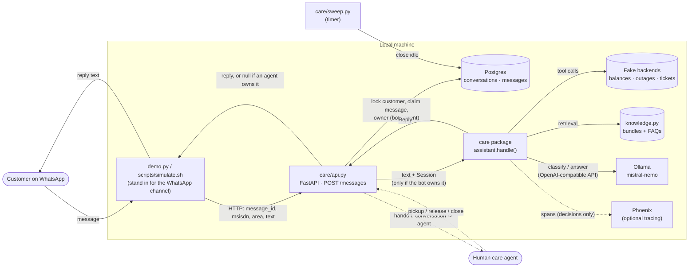
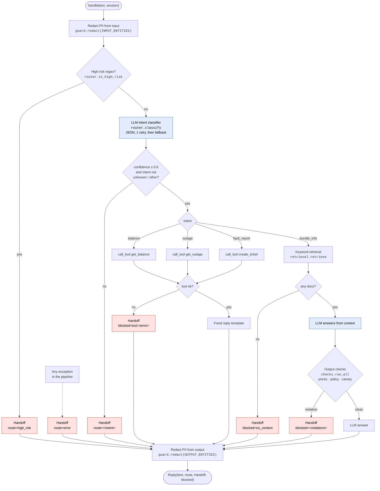
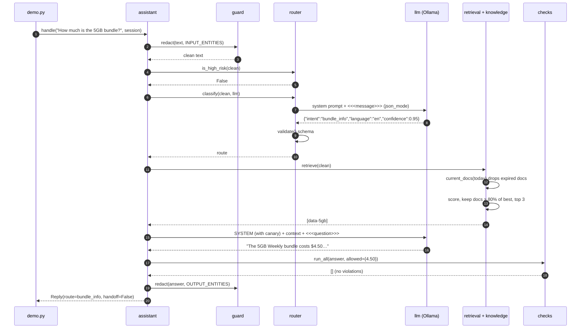
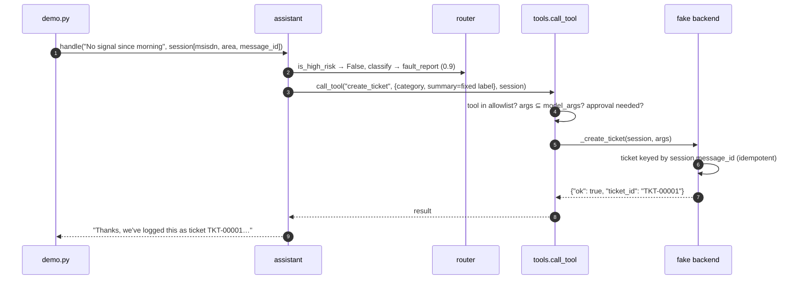
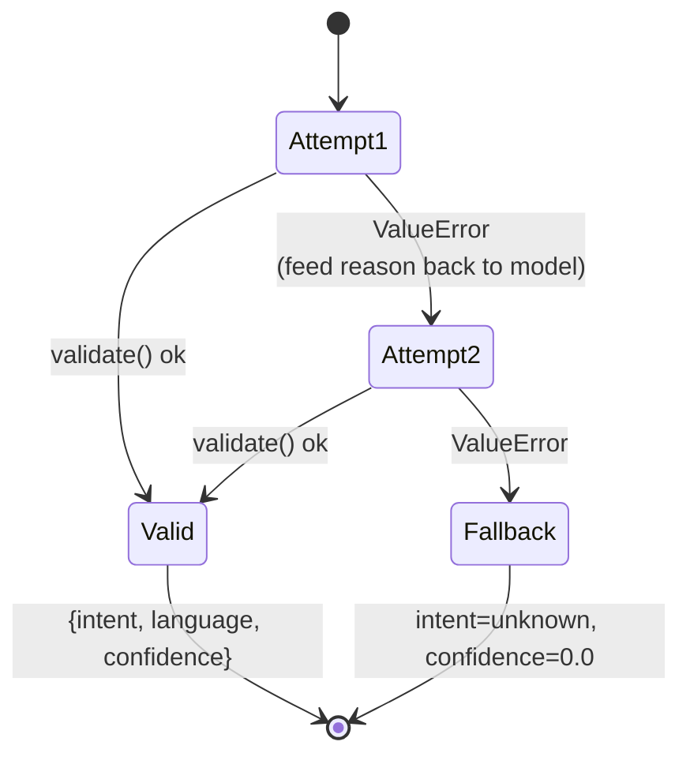
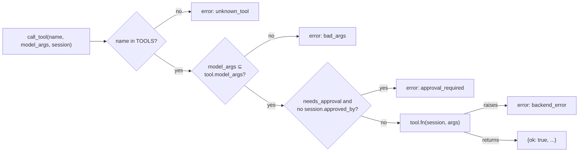
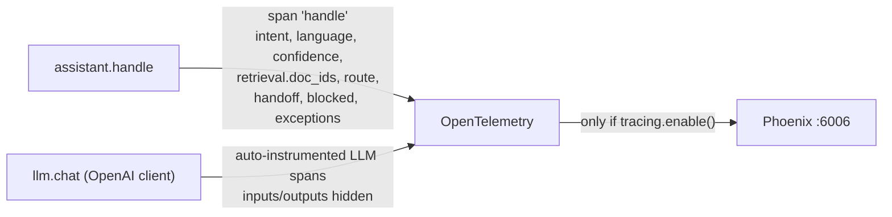
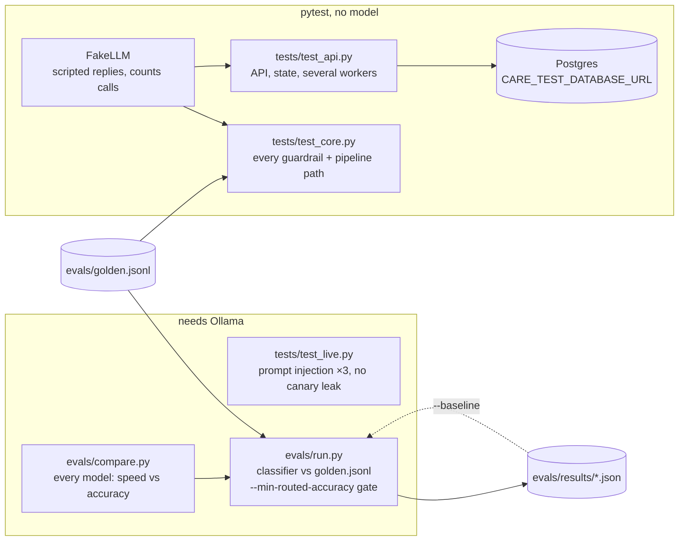
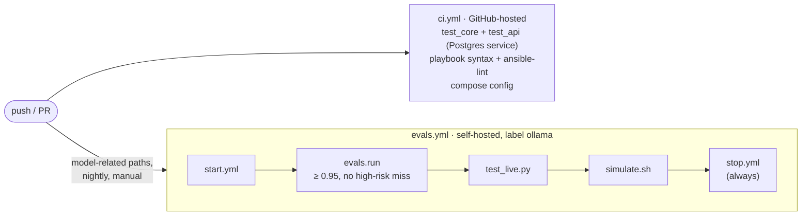

# Architecture

How a WhatsApp message turns into a reply, and where each guardrail sits.
For a module-by-module reference see [components.md](components.md); for the
conversation state, see [data-model.md](data-model.md).

> Diagrams are [Mermaid](https://mermaid.js.org/). GitHub renders them inline;
> in an editor, use a Mermaid preview extension.

## 1. System context

What runs where. Everything is local: no cloud LLM, no real backends.

There is no WhatsApp integration yet. `scripts/simulate.sh` (over the API) and
`demo.py` (calling `handle()` directly, with no state) play the channel's role.
They supply the phone number, area and message ID that a real webhook would
fill from WhatsApp metadata.

A handoff moves the conversation to `agent` in Postgres, and the bot stays
quiet until an agent releases or closes it (see [§10](#10-conversation-lifecycle)). The agent desk itself
isn't built: the endpoints exist, but nothing notifies an agent yet.

## 2. Message pipeline

`care/assistant.py: handle()` is the single entry point. Every path ends in
either an answer or a handoff. Nothing returns an error to the customer.

Blue boxes are the only two places the model is used. Red boxes are handoffs.

Points the diagram makes explicit:

- **High-risk messages make zero LLM calls.** The regex runs before the classifier.
- **The classifier and retrieval both see redacted text**, never the raw message.
- **Output checks only apply to LLM-written text** (`bundle_info`). Balance,
  outage and fault replies are fixed templates filled from tool results, so
  there's nothing for the model to get wrong.
- **Output redaction runs on every reply**, handoffs included.
- **`language` is recorded but not used for routing yet.**

## 3. Sequence: a bundle question

The most involved path, and the only one with two model calls.

If the model had said `$4.00` (the superseded price), `check_prices` would
return `price_not_in_context:4.0` and the customer would get the handoff text.

## 4. Sequence: a tool route (fault report)

Tool routes never let the model touch identity or free text.

A WhatsApp retry of the same message carries the same `message_id`, so it gets
the same ticket instead of a duplicate.

## 5. Classifier contract

`validate()` rejects: non-JSON, non-object, intent outside
`{bundle_info, balance, outage, fault_report, other}`, language outside
`{en, sn, nd, other}`, confidence that isn't a number in `[0, 1]` (booleans
rejected). The fallback always ends in a handoff.

## 6. Tool gate

Identity (`msisdn`), `area` and the idempotency key (`message_id`) come from
the `Session`. The model can't pass them because no tool declares them in
`model_args`.

## 7. Reply outcomes

Every reply is a `Reply(text, route, handoff, blocked)`. This table lists
every way one can be produced.

| Situation | `route` | `handoff` | `blocked` |
|---|---|---|---|
| Balance found | `balance` | False | `[]` |
| Outage lookup (with or without an outage) | `outage` | False | `[]` |
| Ticket created | `fault_report` | False | `[]` |
| Bundle answer passed all checks | `bundle_info` | False | `[]` |
| High-risk regex matched | `high_risk` | True | `[]` |
| Classifier said `other` | `other` | True | `[]` |
| Classifier failed twice | `unknown` | True | `[]` |
| Confidence < 0.6 | the intent, e.g. `balance` | True | `[]` |
| Tool returned an error | the intent | True | `["tool:not_found"]` etc. |
| Retrieval found nothing | `bundle_info` | True | `["no_context"]` |
| Answer failed output checks | `bundle_info` | True | e.g. `["price_not_in_context:4.0", "canary_leak"]`, or `["price_unparsed:four five dollars"]` |
| Any exception | `error` | True | `["exception:<Type>"]` |

## 8. Observability

Without `tracing.enable()` (i.e. without `demo.py --trace`), the OpenTelemetry
calls are no-ops. Spans never contain message text or model output.

## 9. Testing and evals

CI runs these automatically:

`test_core.py` also checks the high-risk regex against the `high_risk` labels in
`golden.jsonl`, so the regex and the eval labels can't drift apart.

## 10. Conversation lifecycle

Over the API, messages from one customer form a conversation that opens,
continues within a window (24 h by default), and closes as `timeout`,
`abandoned`, `resolved` or `agent_resolved`. The state diagram, close
reasons, tables and locking are in [data model](data-model.md#lifecycle).
