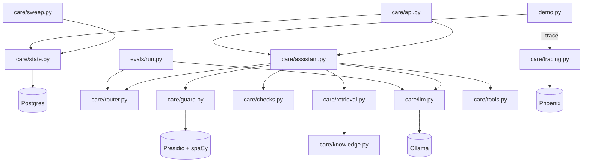

# Components

What every module does, what it exposes, and why it's built the way it is.
For how they fit together, see [architecture.md](architecture.md).

## Dependency map

Arrows point from a module to what it imports. `llm.py` is the only module
that knows about Ollama; everything else takes an `llm` callable, which is what
lets the tests swap in a fake.

`router.py`, `checks.py`, `tools.py` and `knowledge.py` have no project
imports. They're pure and testable on their own.

---

## `care/assistant.py` — the pipeline

**Role:** orchestrates one message end to end and owns the route handlers.

| Name | What it is |
|---|---|
| `handle(text, session, llm=llm.chat) -> Reply` | Public entry point. Opens the `handle` span, runs the pipeline, turns any exception into a handoff, redacts output, records decision attributes. |
| `Reply` | Dataclass: `text`, `route`, `handoff`, `blocked` (list of reason strings), plus `intent` and `confidence` from the classifier (`None` if the model wasn't asked). |
| `HANDOFF_TEXT` | The one message a customer sees on any handoff. |
| `SYSTEM` | System prompt for bundle answers. Contains the canary from `checks.CANARY`. |
| `_pipeline` | redact → high-risk → classify, then `_dispatch`. |
| `_dispatch` | Confidence gate and `other`/`unknown` handoff, then picks the route handler by intent (`bundle_info` is the fallthrough). |
| `_balance`, `_outage`, `_fault` | Call one tool each and fill a fixed template. No model involved. |
| `_bundle` | Retrieve → answer with the model → run output checks. |

**Design notes**

- The fault ticket's `summary` is a fixed label. Customer text never reaches a
  backend from here.
- `_bundle` computes the allowed prices from the retrieved docs only, so the
  price check is relative to what the model was actually shown.
- The customer message is wrapped in `<<<` `>>>` delimiters in prompts so the
  model can tell data from instructions.

---

## `care/router.py` — high-risk rules and intent classifier

**Role:** decides where a message goes.

| Name | What it is |
|---|---|
| `HIGH_RISK` | Compiled regex: SIM swap/replace/change, PIN/PUK/password, reverse/reversal/refund, "money back", sent/paid to the wrong number. |
| `is_high_risk(text) -> bool` | Regex search. Runs before the model. |
| `INTENTS` | `bundle_info`, `balance`, `outage`, `fault_report`, `other`. |
| `LANGUAGES` | `en`, `sn` (Shona), `nd` (Ndebele), `other`. |
| `CONF_MIN` | `0.6`. Below this, hand off. |
| `FALLBACK` | `{"intent": "unknown", "language": "other", "confidence": 0.0}`. |
| `validate(raw) -> dict` | Parses and checks classifier JSON; raises `ValueError` with a reason the model can act on. |
| `classify(text, llm) -> dict` | Calls the model in JSON mode. On invalid output, sends the error back once and retries. Then falls back. |

**Design notes**

- High-risk detection is regex on purpose: it's deterministic, auditable, and
  can't be talked out of its decision by a prompt injection.
- The classifier prompt tells the model to put injection attempts under
  `other`, which hands off.
- `unknown` is never returned by the model; it only comes from `FALLBACK`.

**To change:** add a high-risk phrase → edit `HIGH_RISK`, add a labelled case
to `evals/golden.jsonl` (`test_high_risk_regex_matches_golden_labels` will
check it). Add an intent → [add an intent](../how-to/add-an-intent.md).

---

## `care/retrieval.py` — keyword retrieval

**Role:** picks which knowledge docs the model may see for a bundle question.

| Name | What it is |
|---|---|
| `STOPWORDS` | Common words plus generic shopping words ("bundle", "price", "buy"…) that would otherwise match every doc. |
| `tokens(text) -> set[str]` | Lowercase alphanumeric tokens minus stopwords. |
| `score(q_tokens, doc) -> int` | `2 × (title + keyword hits) + body hits`. |
| `retrieve(question, today=None, k=3, ratio=0.8) -> list[dict]` | Scores current docs; keeps those with score > 0 and ≥ 80% of the best; returns at most 3. |

**Design notes**

- The relative cut (`ratio`) is a **safety control**, not a relevance tweak.
  Every price in a returned doc becomes an "allowed" price for the answer. If a
  neighbouring bundle slipped in with a low score, its price could pass the
  check. With the cut, "How much is the 5GB bundle?" returns only `data-5gb`.
- No match → empty list → the pipeline hands off without calling the model.

---

## `care/knowledge.py` — catalogue

**Role:** the single source of truth for bundle prices and FAQ answers.
**Sample data only.**

| Name | What it is |
|---|---|
| `BUNDLES` | Dicts with `id`, `title`, `price_usd`, `keywords`, `text`, `effective_from`, `expires`. |
| `FAQS` | Same shape, without `price_usd`. |
| `current_docs(today=None)` | Docs where `effective_from ≤ today ≤ expires` (or no expiry). |

**Design notes**

- `data-5gb-old` ($4.00, expired end of 2025) is deliberate: it proves stale
  prices are filtered out (`test_stale_price_not_served`).
- Named `knowledge.py`, not `catalogue.py`, because `catalogue` is a spaCy
  dependency and the name would shadow it.

**To change a price:** add a new doc with a new `effective_from` and set
`expires` on the old one, rather than editing the price in place. That keeps
the history and lets you schedule changes. See
[change bundles](../how-to/change-bundles.md).

---

## `care/checks.py` — output checks

**Role:** deterministic checks on model-written text. No model involved. Each
function returns a list of violation strings; empty means clean.

| Name | Catches | Violation string |
|---|---|---|
| `check_prices(answer, allowed)` | Any price not in the retrieved docs, in digits (`$1`, `US$ 2`, `2.00 USD`, `2.00$`) or with a currency word (`2 dollars`, `four dollars fifty`, `a dollar and a half`, `fifty cents`); and any amount in words that doesn't parse | `price_not_in_context:
`, `price_unparsed:<words>` |
| `check_policy(answer)` | "guarantee", "refund", "free forever", "I reversed", "your PIN is", "I swapped your SIM" | `banned:<pattern>` |
| `check_canary(answer)` | The `CANARY` string (signals a system-prompt leak) | `canary_leak` |
| `run_all(answer, allowed_prices)` | All three, concatenated | |
| `prices_in(text)` | Helper: every price in a string, in digits or words, as a rounded float. Also used by `test_catalogue_prices_match_text`. | |

**Design notes**

- The canary lives in the bundle-answer system prompt. If it ever shows up in
  output, the model was talked into revealing its instructions.
- Any violation → handoff; the bad answer is never sent, even partially.
- Two matchers read prices. `_PRICE` handles symbol forms; `_word_prices`
  tokenises the text and reads the number around every currency word, using
  `_words_to_number` (0–999, "a", "half a", "point"). Cents after the dollar
  word count when they look like cents ("fifty", "50") or say "cents", so
  "2 dollars, 7 days" stays $2. A currency word with no number ("the dollar
  bundle") isn't a price.
- **Not read as a price:** a bare number with no currency word ("four fifty").
  The bundle prompt asks for prices exactly as written, in digits.

---

## `care/guard.py` — PII redaction

**Role:** strips personal data from input before the model sees it, and from
output before the customer sees it.

| Name | What it is |
|---|---|
| `zw_phone` | Custom recogniser: `+263 7x xxx xxxx` / `07x xxx xxxx`. |
| `zw_id` | Custom recogniser: Zimbabwean national ID, e.g. `63-123456 K 42`. |
| `IntroducedNameRecognizer` | `PERSON` for the 1–3 words after "I'm", "I am", "this is", "it's" (capitalised) or "my name is" (any case). Skips non-names such as "I'm unable", "this is urgent", and stops at words such as "and". |
| `zw_names` | `PERSON` deny list of common Shona and Ndebele names, loaded from `care/zw_names.txt`; case-insensitive, whole words. |
| `OUTPUT_ENTITIES` | `ZW_PHONE`, `ZW_NATIONAL_ID`, `PHONE_NUMBER`, `EMAIL_ADDRESS`, `CREDIT_CARD`, `IBAN_CODE`. |
| `INPUT_ENTITIES` | `OUTPUT_ENTITIES` + `PERSON`. |
| `redact(text, entities=None) -> str` | Presidio analyse + anonymise; replaces hits with `<ENTITY_TYPE>`. |

**Design notes**

- `PERSON` is input-only: spaCy tags invented bundle names as people, which
  would mangle answers on the way out.
- The English spaCy model misses many Zimbabwean names ("Tendai Moyo" came
  out as "Tendai `<PERSON>`"), hence the two extra `PERSON` recognizers.
  `zw_names.txt` is a starter list for a native speaker to review. It leaves
  out names that are also English words (Blessing, Gift, Precious…), because
  redaction runs before retrieval and "gift" is a catalogue keyword.
  `test_input_redaction_leaves_the_catalogue_alone` guards that.
- `LOCATION`, `DATE_TIME` and `NRP` are excluded everywhere: spaCy tags the
  "GB" in "5GB" as a location, which breaks retrieval.
- `PHONE_NUMBER` stays alongside `ZW_PHONE` because it catches 9-digit numbers
  the custom pattern misses.
- Loads the `en_core_web_lg` spaCy model at import, so the first import is slow.
- `python -m care.guard` runs a quick redaction demo.

---

## `care/tools.py` — tool allowlist and fake backends

**Role:** the only way the bot can touch backend systems.

| Name | What it is |
|---|---|
| `Session` | `msisdn`, `area`, `message_id`, `approved_by`. Filled by the channel, never by the model. |
| `Tool` | `name`, `model_args` (what the model may pass), `needs_approval`, `fn`. |
| `TOOLS` | The allowlist (below). |
| `call_tool(name, model_args, session) -> dict` | Checks allowlist → args → approval → runs `fn`. Never raises. |
| `reset_fakes()` | Clears tickets and reversals between tests. |

| Tool | Model may pass | Approval | Used by |
|---|---|---|---|
| `get_balance` | nothing | no | `balance` route |
| `get_outage` | nothing | no | `outage` route |
| `create_ticket` | `category`, `summary` | no | `fault_report` route |
| `reverse_transaction` | `txn_id` | **yes** | nothing yet; exists to prove money-moving tools are gated |

**Design notes**

- `create_ticket` is idempotent on `message_id`, so WhatsApp redelivery doesn't
  open duplicate tickets.
- Errors are structured: `unknown_tool`, `bad_args`, `approval_required`,
  `backend_error`, `not_found`. The pipeline turns them into handoffs with
  `blocked=["tool:<error>"]`.
- Fake data: number `263772000001` has a balance; area `harare-cbd` has a
  planned-maintenance outage.

---

## `care/llm.py` — model client

**Role:** the only module that talks to Ollama.

| Name | What it is |
|---|---|
| `MODEL` | `mistral-nemo:latest`, chosen by the 2026-10-29 comparison ([decision 0002](../decisions/0002-local-model-mistral-nemo.md)) |
| `chat(messages, json_mode=False) -> str` | OpenAI-compatible call to `localhost:11434/v1`, temperature 0, 60s timeout. `json_mode` sets `response_format=json_object`. |

To change model or provider, edit this file only. Anything with the same
`chat(messages, json_mode=...) -> str` signature will work. See
[change the model](../how-to/change-the-model.md).

---

## `care/tracing.py` — optional tracing

**Role:** sends OpenTelemetry spans to Phoenix when switched on. The client
(`arize-phoenix-otel`) is in `requirements.txt`; the Phoenix server/UI is a
separate `pip install arize-phoenix`.

`enable(project="care-bot", endpoint="http://localhost:6006/v1/traces")`
registers a Phoenix tracer provider and instruments the OpenAI client with
inputs and outputs hidden. Imports are inside the function, so Phoenix isn't
loaded unless tracing is enabled.

---

## `care/api.py` — HTTP API

**Role:** what the WhatsApp integration and the agent desk call. It wraps
`handle()` with conversation state: `post_message` runs inside `Store.turn`,
skips the bot when an agent owns the conversation, and records each outcome.

| Name | What it is |
|---|---|
| `create_app(token=None, store=None, llm=None)` | App factory (`uvicorn care.api:create_app --factory`). Reads `CARE_API_TOKEN` and, through `store_from_env`, `CARE_DATABASE_URL`. Tests pass a `Store` and a fake `llm`. |
| `InboundMessage`, `MessageResult`, `Pickup`, `Close` | Request and response models; input limits live here. |
| `auth` | Constant-time bearer-token check on every route except `/health`. |

Every endpoint, shape and status code is in [api.md](api.md).

---

## `care/state.py` — conversation state

**Role:** customers, their conversations, message outcomes, and an event log
for churn analysis, in Postgres.

| Name | What it is |
|---|---|
| `Store(url, max_size=10, window=24h)` | Connection pool plus every operation. `turn(msisdn)` is the per-message transaction; `pickup`, `release`, `close_conversation`, `close_idle`; reads `conversation`, `conversations`, `messages`, `events`. |
| `Turn` | One message inside the lock: `claim`, `conversation` (opened lazily), `hand_off`, `finish`, `status_of`. |
| `Conversation`, `Outcome`, `Event` | Row dataclasses. |
| `NotFound`, `Conflict` | Raised by agent actions; the API maps them to 404 and 409. |
| `store_from_env()` | `Store` from `CARE_DATABASE_URL` and `CARE_CONVERSATION_WINDOW_HOURS`. |

Tables, the lifecycle, and the locking design are in
[data-model.md](data-model.md).

---

## `care/sweep.py` — close idle conversations

`python -m care.sweep` calls `Store.close_idle()` once and prints how many
conversations it closed. `start.yml` installs a systemd user timer that runs
it every 15 minutes. It imports only `care.state`, so it doesn't load the model
pipeline.

---

## `demo.py` — terminal chat

Reads lines from stdin, builds a fresh `Session` per message (fake number,
`harare-cbd`, random `wamid.<uuid>` message ID), calls `handle()`, prints the
reply and `[route=… handoff=… blocked=…]`. `--trace` enables Phoenix and
flushes spans on exit.

---

## `evals/` — classifier evaluation

| File | What it is |
|---|---|
| `golden.jsonl` | Labelled messages: `text`, `intent`, `high_risk`. Scored by the runner and used by `test_core.py`. |
| `routes.jsonl` | Extra phrasings per route, including look-alikes of high-risk requests. Manual testing only for now. |
| `run.py` | Runs the high-risk regex and real classifier over `golden.jsonl`. Reports intent accuracy (overall and per intent), routed accuracy, high-risk recall and precision, fallback rate, per-message latency, and every miss. Saves to `evals/results/<timestamp>.json`; `--baseline FILE` prints deltas. `--min-routed-accuracy X` exits 1 if routed accuracy is below X or high-risk recall is below 1.0 (the CI gate). |
| `compare.py` | Runs `run.py` once per Ollama model and builds a speed-vs-accuracy matrix, Pareto front and scatter. Inputs, metrics and outputs are in [evals.md](evals.md). |

High-risk cases are scored on the regex only, mirroring the pipeline, where
they never reach the model.

---

## `migrations/` — database schema

Alembic, with plain-SQL migrations; the URL comes from `CARE_DATABASE_URL`
(`migrations/env.py`). Every schema change is a new numbered file with
`upgrade()` and `downgrade()`, and `alembic upgrade head` applies whatever a
database is missing. Alembic records each database's revision in its
`alembic_version` table. That way a laptop, CI and production can each be at
a different point and still get exactly the changes they lack, without
dropping data. `start.yml` and the Postgres tests both run it. What each
revision does is listed in [data model](data-model.md#migrations); how to add
one is in [add a migration](../how-to/add-a-migration.md).

---

## `compose.yaml` — Postgres for development

`postgres:18-alpine` on `127.0.0.1:5433`. Override the host port with
`CARE_PG_PORT`; CI uses 5434 so it can run beside a dev stack. It creates the
`care` database, and `docker/postgres/01-test-db.sql` creates `care_test` the
first time the volume is made. Data is kept in the `pgdata` volume. The
credentials (`care`/`care`) are for development only.

---

## `deploy/ansible/` — start and stop the stack

| File | What it is |
|---|---|
| `start.yml` | venv (first run, or `install_deps=true`) → Ollama and the model from `care/llm.py` → Postgres (`postgres_mode=docker`, `system`, or `external` with your own `database_url`) → `alembic upgrade head` → token and env file in `~/.config/care-bot/` (0600) → systemd user services for the API and the sweeper timer → waits for `/health`. Safe to rerun; the API is always restarted. |
| `stop.yml` | Stops the sweeper timer and the API, then Postgres, then Ollama. Keeps all data. A system or external Postgres is left running (a system one stops with `stop_system_postgres=true`). |
| `vars.yml` | Every setting: paths, Postgres mode and port, workers, `manage_ollama`, `api_service`, `conversation_window_hours`, `sweep_interval`, what to stop. Override any of them with `-e`. |
| `templates/` | The API unit, the sweeper service and timer (`<api_service>-sweep`), and the env file. |
| `inventory.ini` | Localhost only. |

`manage_ollama=false` skips the sudo-only Ollama service tasks; that's how CI
runs. Both playbooks pass `ansible-lint --profile production`.

---

## `scripts/simulate.sh` — simulated WhatsApp traffic

Bash, curl and jq. The default mode walks through:

- one message per route;
- a redelivered message;
- a high-risk handoff, after which the bot stays quiet;
- a release, after which the bot answers again;
- the conversation view, with its events and per-message intent and latency;
- an agent pickup and close, after which the next message opens a new
  conversation;
- rejected requests (bad token, text too long, bad msisdn).

Each line shows the conversation the message landed in. Each section starts by
releasing the conversation (a 409 there means the bot already owned it).
`load N` sends N bundle questions at once from different numbers. Set `BASE_URL` and `CARE_API_TOKEN`
to point it elsewhere.

---

## `.github/` — CI

| File | What it is |
|---|---|
| `workflows/ci.yml` | GitHub-hosted, on every push to `main` and every PR: `test_core.py` and `test_api.py` against a Postgres service container, a playbook syntax check plus `ansible-lint`, and `docker compose config`. |
| `workflows/evals.yml` | Self-hosted runner labelled `ollama`, on model-related PRs, pushes to `main`, nightly and on demand. Runs `start.yml`, the eval gate, `test_live.py`, `simulate.sh`, then `stop.yml` (always). Uploads the results. Never runs for forks. |
| `actionlint.yaml` | Declares the `ollama` runner label for `actionlint`. |

Runner setup is in [CI](../how-to/ci.md).

---

## `tests/`

| File | Needs | Covers |
|---|---|---|
| `test_core.py` | nothing (uses `FakeLLM`) | Redaction, tool gating and idempotency, price/policy/canary checks, retrieval cut and stale docs, classifier retry/fallback, high-risk regex vs golden labels, zero LLM calls on high-risk, every pipeline handoff path |
| `test_api.py` | `CARE_TEST_DATABASE_URL` (skipped without it; the tests wipe it) | Answers and status, redelivery dedupe, handoff gives the conversation to an agent and the bot stays quiet, release, state survives restart, no customer text stored, auth, input limits. Across workers: one customer is handled one message at a time, different customers run in parallel, a raced message is processed once, release waits for a message in progress, a crash releases the claim. Lifecycle: messages continue one conversation; idle ones close as `timeout` or `abandoned`; pickup, release and close (with their 404s and 409s); the event sequence; a second handoff needs a new pickup; a first-message race opens one conversation; the sweeper closes only idle conversations and doesn't race a turn; migration 0002 backfills 0001 data and downgrades |
| `conftest.py` | — | The `db_url` fixture: runs the migrations once against `CARE_TEST_DATABASE_URL`, then truncates the tables before each test. Without the variable, those tests are skipped. `migrate()` steps the schema up or down for the migration tests. |
| `test_live.py` | Ollama running | Prompt injection doesn't leak the canary, run 3 times (all must pass) |

`FakeLLM` returns scripted replies in order and counts calls, so tests can
assert things like "high-risk messages make zero model calls".
