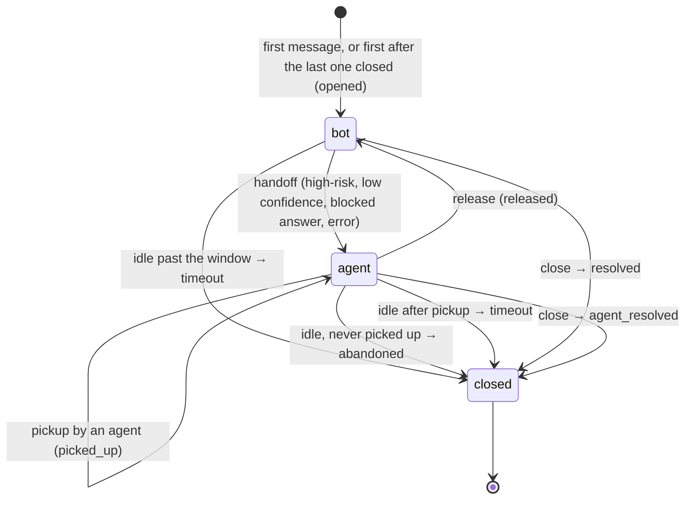

# Data model

Postgres, managed by [`care/state.py`](../../care/state.py), with its schema
in [`migrations/`](../../migrations/versions/). Customer text is never stored,
only decisions and the bot's reply, which has already been redacted
([decision 0005](../decisions/0005-no-customer-text-stored.md)).

## Tables

| Table | Columns |
|---|---|
| `customers` | `customer_id` (uuid key), `msisdn` (unique), `first_seen`, `last_seen` |
| `conversations` | `conversation_id` (uuid key), `customer_id`, `status` (`bot`/`agent`/`closed`), `opened_at`, `last_activity_at`, `handoff_at`, `handoff_reason`, `agent_id`, `picked_up_at`, `closed_at`, `close_reason` |
| `messages` | `message_id` (key), `msisdn`, `conversation_id`, `received_at`, `route`, `intent`, `confidence`, `latency_ms`, `handoff`, `blocked`, `reply` |
| `events` | `event_id`, `conversation_id`, `customer_id`, `type` (`opened`, `handoff`, `picked_up`, `released`, `closed`), `at`, `payload` |

Constraints worth knowing:

- **At most one open conversation per customer:** a partial unique index on
  `conversations (customer_id) WHERE status <> 'closed'`.
- **Closed means closed:** `status = 'closed'` exactly when `closed_at` and
  `close_reason` are both set (a check constraint).
- **`close_reason`** and **`events.type`** only take the values listed here.

## Lifecycle

A customer has many conversations over time. A conversation continues while
the customer writes within the window: `Store(url, window=timedelta(hours=24))`,
or `CARE_CONVERSATION_WINDOW_HOURS`, which matches WhatsApp's 24 h
customer-service window. Every arrow below also writes a row to `events`.



| `close_reason` | When |
|---|---|
| `timeout` | idle past the window (the bot owned it, or an agent had picked it up) |
| `abandoned` | idle past the window after a handoff nobody picked up |
| `resolved` | closed through the API while the bot owned it |
| `agent_resolved` | closed by an agent |

- **Agent-owned:** while an agent owns the conversation, messages are recorded
  but the bot doesn't reply.
- **Second handoff:** a new handoff after a release clears `agent_id` and
  `picked_up_at`, so it has to be picked up again. The event log keeps the
  full history.
- **Idle closing:** the window is checked when the customer's next message
  arrives (`_current` in `state.py`), and by `close_idle()`, which
  `care/sweep.py` runs on a timer. That way idle conversations close even if
  the customer never writes again. Correctness doesn't depend on the sweeper;
  it only keeps metrics fresh.
- **Churn signals** come from these rows:
  - repeat contact: several conversations within a few days;
  - abandonment: `close_reason`;
  - time to pickup: `picked_up_at - handoff_at`;
  - contacts per customer.

## Concurrency

Each inbound message gets one transaction (`Store.turn`) that:

1. takes `pg_advisory_xact_lock` on the msisdn. One customer's messages run one
   at a time across every worker, while different customers don't wait on each
   other;
2. claims the message by inserting its `message_id` first (`ON CONFLICT DO
   NOTHING`). If the row already exists, it's a redelivery and the stored
   outcome is returned. Two workers racing on the same message can't both
   process it, because the second insert waits on the first and then conflicts;
3. opens or continues the conversation (`Turn.conversation`, only once the
   message is known to be new), runs the bot, writes the outcome, then commits,
   which releases the lock.

If a worker dies mid-message, the transaction rolls back along with the claim
and any conversation it opened, so WhatsApp's redelivery is processed from
scratch. `pickup`, `release`, `close_conversation` and each conversation
`close_idle` closes take the same lock. None of them can land mid-message and
then be overwritten by that message's handoff.

The lock is held through the model call, so each in-flight message holds one
pooled connection. `Store(url, max_size=10)` caps in-flight messages per
worker; keep `workers × max_size` under Postgres's `max_connections`.
Per-customer ordering through a queue (Kafka keyed by msisdn) removes that cost
later, without changing the schema. See
[decision 0004](../decisions/0004-per-customer-advisory-lock.md) and
[0006](../decisions/0006-kafka-later.md).

## Migrations

| Revision | What it does |
|---|---|
| `0001_initial` | `conversations` (one row per msisdn: status, reason) and `messages`. |
| `0002_conversations` | Adds `customers` and `events`, rebuilds `conversations` around `conversation_id`, and adds intent, confidence and latency to `messages`. Its upgrade backfills 0001 data: each msisdn becomes a customer with one open conversation that keeps its status. Its downgrade keeps each open conversation and drops the closed history. |

How to add one: [add a migration](../how-to/add-a-migration.md).

## Handy queries

```sql
-- Median minutes from handoff to pickup, last 7 days
SELECT percentile_cont(0.5) WITHIN GROUP (ORDER BY extract(epoch FROM picked_up_at - handoff_at) / 60)
FROM conversations WHERE picked_up_at IS NOT NULL AND handoff_at > now() - interval '7 days';

-- Close reasons this week
SELECT close_reason, count(*) FROM conversations
WHERE closed_at > now() - interval '7 days' GROUP BY 1 ORDER BY 2 DESC;

-- Customers with 3+ conversations in 7 days (repeat contact)
SELECT cu.msisdn, count(*) FROM conversations c JOIN customers cu USING (customer_id)
WHERE c.opened_at > now() - interval '7 days' GROUP BY 1 HAVING count(*) >= 3;
```
