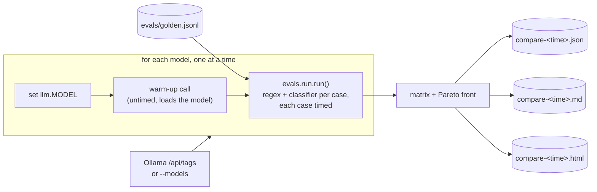

# Evals

How the classifier is scored (`evals/run.py`) and how models are compared
(`evals/compare.py`). For a hands-on walkthrough see
[learn: evals](../learn/05-evals.md); for the files see the `evals/` section in
[components.md](components.md#evals--classifier-evaluation). The latest
comparison and the resulting model choice are in
[decision 0002](../decisions/0002-local-model-mistral-nemo.md).

## Model comparison

```bash
python -m evals.compare                                    # every installed model
python -m evals.compare --models llama3:8b mistral:latest  # just these
```

Needs Ollama running (`ollama serve`) and the models pulled.

CI runs the single-model gate (`python -m evals.run --min-routed-accuracy
0.95`) on every relevant PR and nightly; see [CI](../how-to/ci.md).

## What it does



1. Gets the model list from `--models`, or otherwise from every model Ollama
   reports as installed (`GET /api/tags`, the same list as `ollama list`).
2. For each model, sets `llm.MODEL` in memory. `care/llm.py` itself is not
   changed.
3. Sends one untimed warm-up classification, so loading the model from disk
   isn't counted against it. If the warm-up fails (model missing, Ollama
   down), the model is listed as failed and skipped.
4. Calls `evals.run.run()`, the same scoring the single-model runner uses, so
   the numbers can be compared with `python -m evals.run` results.
5. Builds the matrix, works out the Pareto front and writes the outputs.

Models run one after another, never in parallel, so they don't compete for
CPU or memory.

## Inputs

| Input | Where from | Notes |
|---|---|---|
| Golden set | `evals/golden.jsonl` | 31 cases: `text`, `intent`, `high_risk`. 7 are high-risk; the other 24 reach the model. |
| Models | `--models a b c`, or all installed | Any Ollama model name, e.g. `qwen3:8b`. |
| Classifier prompt and contract | `care/router.py` (`SYSTEM`, `validate`, `CONF_MIN = 0.6`) | The same prompt, JSON contract and one retry as production. |
| Model settings | `care/llm.py` | Temperature 0, JSON mode, 60 s timeout per call. |

The 24 model-routed cases are split by intent: `bundle_info` 7, `other` 6,
`balance` 4, `fault_report` 4, `outage` 3.

## What it measures

Accuracy is scored only on the 24 non-high-risk cases. High-risk cases are
handled by the regex before the model, as in production, so the high-risk
numbers are the same for every model.

| Metric | Meaning |
|---|---|
| `routed_accuracy` | **Main accuracy number.** Share of cases where the intent is right **and** confidence ≥ 0.6, i.e. the bot would act on it without handing off. |
| `intent_accuracy` | Share of cases where the intent is right, whatever the confidence. |
| `per_intent` | `correct/total` for each intent. |
| `fallback_rate` | Share of cases that got `unknown`: invalid JSON twice, or a call error. Each one is a handoff. |
| `call_errors` | Cases where the call raised, e.g. a timeout. Counted as a handoff, as the pipeline does. |
| `latency_mean_s` | **Main speed number.** Mean seconds per message for `router.classify`, retry included. |
| `latency_p50_s`, `latency_p95_s` | Median and 95th percentile per message. With 24 cases, p95 is the second-slowest message. |
| msgs/min | `60 / latency_mean_s`, a rough throughput for one worker. |
| `high_risk_recall`, `high_risk_precision` | Regex only; identical across models. |
| `wall_s` | Total seconds for the model's run, warm-up excluded. |

**Pareto front:** a model is on the front if no other model is at least as
accurate (`routed_accuracy`) **and** at least as fast (`latency_mean_s`), and
strictly better on one of them. Every model off the front is beaten on both by
some other model, so the choice is between the front models. The most accurate
model is reported separately, with ties broken by speed.

## Outputs

All files go to `evals/results/`, which is gitignored. The same timestamp
names one run, e.g. `compare-20261029-083735.*`.

| File | Contents |
|---|---|
| `compare-<time>.json` | One object per model: every metric above, plus `errors` (each miss as `text`, `want`, `got`). Failed models appear as `{"model", "failed"}`. |
| `compare-<time>.md` | The matrix as a markdown table, sorted by routed accuracy then speed, with a `pareto` column. |
| `compare-<time>.html` | Interactive scatter: x = mean latency (bar out to p95), y = routed accuracy. Pareto models are a separate colour. Loads plotly from a CDN. |

The console prints one line per model as it finishes, then the matrix, the
most accurate model and the Pareto front.

For a full example, see the 2026-10-29 run in [decision 0002](../decisions/0002-local-model-mistral-nemo.md#results-2026-10-29).

## Reading the results

- **Small set.** With 24 cases, one case moves accuracy by about 4 points. Treat
  gaps of one or two cases as a tie, and add golden cases before relying on a
  narrow win.
- **Latency depends on the machine.** Numbers are wall-clock on whatever runs
  the script. Compare models from the same run, and keep other heavy work off
  the machine while it runs.
- **Reasoning models pay for their thinking.** `qwen3` and `gpt-oss` reason
  before answering, and that time is in their latency. Any call over the 60 s
  timeout counts as an error and a handoff, which also lowers accuracy.
- **Single pass.** Temperature is 0, so each case runs once. Small run-to-run
  differences can still happen.
- **Classifier only.** This measures intent routing. It doesn't score bundle
  answers (retrieval + generation) or the output checks.

To adopt a model, follow [change the model](../how-to/change-the-model.md).
